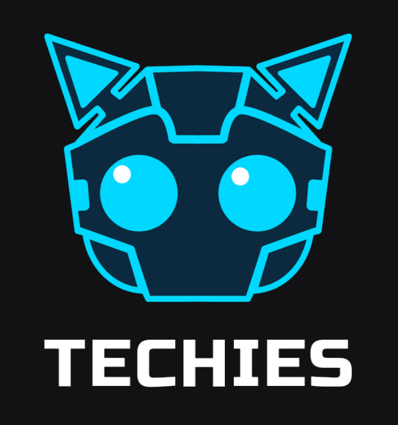
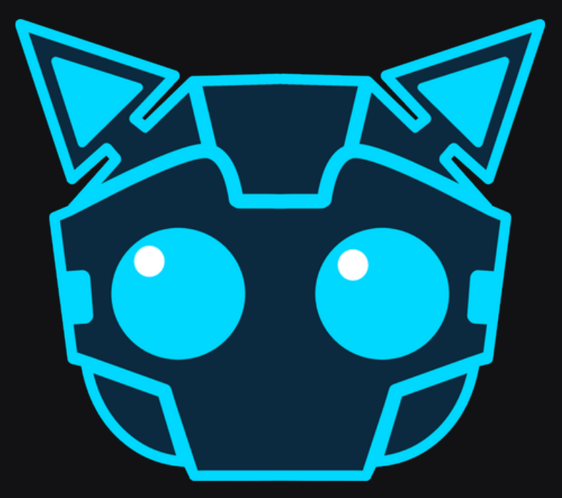

<h1>TECHIES</h1>
<h3>Desarrollo de software a medida · Aplicaciones web y móviles · Sistemas de gestión</h3>

  

  &nbsp;
  &nbsp;
  &nbsp;
  

  
  
  

---

## 🐱 Quiénes somos

En **TECHIES** desarrollamos **software a medida** que convierte las ideas de nuestros clientes en herramientas digitales **confiables, seguras y fáciles de usar**: sistemas de gestión, aplicaciones web y aplicaciones móviles.

Empezamos escuchando y entendiendo el problema antes de proponer una solución. Después te acompañamos desde la idea hasta la puesta en marcha, con comunicación clara y reglas transparentes en plazos, costos y alcances.

<table>
<tr>
<td width="50%" valign="top">

### 🎯 Misión
Acompañar a quienes tienen una idea desde su origen hasta la puesta en marcha, optimizando sus procesos e impulsando sus proyectos.

</td>
<td width="50%" valign="top">

### 🔭 Visión
Ser el aliado tecnológico de quienes quieren llevar una idea a la realidad, creciendo junto a cada proyecto que desarrollamos.

</td>
</tr>
</table>

---

## 🛠️ Qué hacemos

<b>Ver la lista en texto</b>

 

- **Sistemas de gestión:** ordenamos y optimizamos los procesos de tu organización: inventarios, clientes, reportes, facturación y más.
- **Aplicaciones web:** plataformas, paneles administrativos y sitios rápidos, optimizados para buscadores (SEO) y fáciles de usar.
- **Aplicaciones móviles:** tu proyecto siempre a la mano, con una experiencia pensada para Android e iOS.
- **Software a medida:** nada de soluciones genéricas: entendemos tu proceso y luego diseñamos la herramienta.

---

## 🚀 Cómo trabajamos

---

## ✨ Por qué TECHIES

<b>Ver la lista en texto</b>

 

- **Cercanos:** lenguaje claro y trato directo, sin tecnicismos innecesarios
- **Confiables:** cumplimos plazos y explicamos con transparencia
- **Ágiles:** respuestas rápidas y procesos simples, sin burocracia
- **Modernos:** diseño actual y tecnología al día
- **Curiosos:** hacemos preguntas y entendemos tu problema antes de proponer

---

## 💙 Nuestros valores

<b>Ver la lista en texto</b>

 

| Valor | Lo que significa |
|-------|------------------|
| **Confianza** | Cumplimos lo que prometemos y cuidamos la información de nuestros clientes |
| **Compromiso** | Acompañamos cada proyecto desde la idea hasta la puesta en marcha |
| **Calidad** | Entregamos software que funciona bien, es seguro y fácil de usar |
| **Transparencia** | Somos claros en plazos, costos y alcances |
| **Colaboración** | Trabajamos junto al cliente y entre el equipo como un solo grupo |

---

## ⚙️ Tecnologías con las que trabajamos

<b>Ver la lista en texto</b>

 

- **Frontend:** Vue.js, React, SolidJS, Tailwind CSS
- **Backend:** Laravel, Elysia, NestJS, Express.js
- **Móvil:** Flutter, React Native
- **Lenguajes:** JavaScript, TypeScript, PHP, Python, Dart
- **Datos:** PostgreSQL, MySQL, SQLite
- **DevOps:** Git, GitHub

---

## 📂 Proyectos destacados

> Algunos proyectos de clientes son privados. Si quieres ver casos de éxito, [escríbenos](mailto:contacto@dominio.com).

---

## 👥 El equipo

| | Nombre | Rol |
|---|--------|-----|
| 🐱 | [**TU_NOMBRE**](https://github.com/TU_USUARIO) | Fundador y desarrollador |
| 🐱 | [**NOMBRE 2**](https://github.com/USUARIO_2) | Cargo |
| 🐱 | [**NOMBRE 3**](https://github.com/USUARIO_3) | Cargo |

---

## ❓ Preguntas frecuentes

<b>¿Qué tipo de software desarrollan?</b>

 
Desarrollamos software a medida: sistemas de gestión (inventarios, clientes, facturación, reportes), aplicaciones web, paneles administrativos y aplicaciones móviles.

<b>¿Cómo es el proceso de trabajo?</b>

 
Escuchamos tu idea, proponemos alcance, etapas y cronograma, desarrollamos con avances claros y lanzamos con soporte posterior.

<b>¿Con qué tecnologías trabajan?</b>

 
Laravel, Elysia, NestJS y Express.js en backend; Vue, React y Solid en frontend; Flutter (Dart) y React Native para móviles; PostgreSQL, MySQL y SQLite como bases de datos.

<b>¿Cuánto cuesta un proyecto?</b>

 
Depende del alcance. Te enviamos una propuesta clara con costos, etapas y plazos antes de empezar.

---

## 🤝 ¿Tienes una idea?

**Cuéntanos qué proceso te quita más tiempo hoy.**
Te respondemos con una propuesta clara: alcance, etapas y cronograma.

 

**Creciendo contigo, proyecto a proyecto.**

software a medida · desarrollo web · apps móviles · sistemas de gestión · Laravel · Elysia · NestJS · Express · Vue · Solid · Flutter · React Native

<!--
CÓMO PUBLICARLO
1. En tu organización de GitHub crea un repo PÚBLICO llamado exactamente ".github".
2. Dentro crea la carpeta "profile" y sube README.md y la carpeta "assets" con los logos.
   Estructura final: .github/profile/README.md  y  .github/profile/assets/*.png
3. Reemplaza TU_ORG (nombre de la organización), TU_USUARIO_TIKTOK, TU_NOMBRE, dominio.com y el WhatsApp.
4. El perfil aparece en github.com/TU_ORG.

SEO EN GITHUB (hazlo también fuera del README)
- Settings de la organización: completa Description, Website, Email, Location y TikTok y redes sociales.
- En cada repo público: agrega Description y Topics (laravel, elysia, nestjs, expressjs, vuejs, solidjs, flutter, react-native, software-a-medida).
- Fija (pin) tus mejores repos y cambia proyecto-1/proyecto-2 por los reales.
- El enlace al sitio web debe tener su propio SEO (title, meta description, sitemap); GitHub enlaza hacia él.
-->
